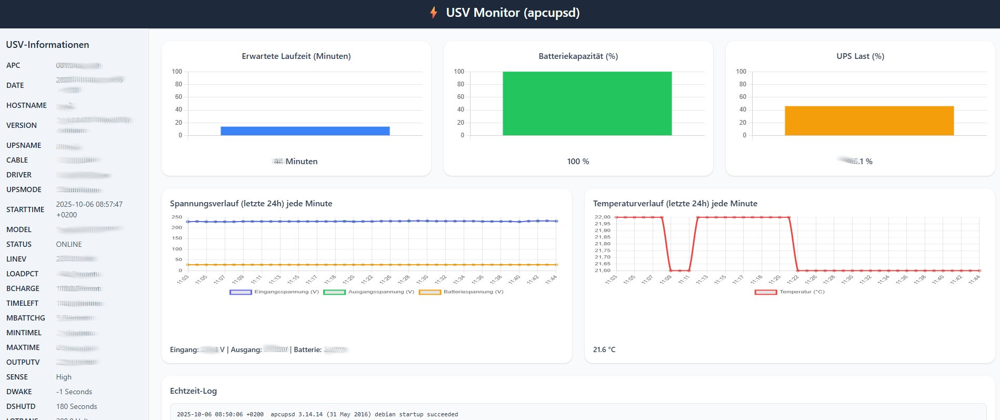

# APC UPS Monitor – Webinterface for apcupsd

[🇩🇪 Deutsch](README_de.md)

A modern web interface for monitoring your APC UPS using apcupsd. It displays real-time status, battery, load, and voltage charts, and publishes all UPS values via MQTT, with power failures sent immediately.




## Features

- Real-time UPS status and event log
- Bar charts for:
  - Estimated runtime (minutes)
  - Battery capacity (%)
  - UPS load (%)
- Line charts (last 24h) for:
  - Battery voltage, output voltage, input voltage
  - Temperature
- Responsive design for desktop and mobile
- CSV-based history storage for long-term charting (24h)
- Systemd service for automatic startup on Debian
- Sending measurements via MQTT

## System Requirements

- Debian / Ubuntu
- Node.js (current LTS version recommended)
- npm
- `apcupsd` installed and configured

## Installation Docker-Compose

### Requirements for Docker-Version
- Install docker with compose plugin
- Set "NETSERVER on" and "NISIP 0.0.0.0" in /etc/apcupsd/apcupsd.conf
- Set the "APC_HOST" variable in the docker-compose.yml file
  
```bash
mkdir /opt/apcupsdif
cd /opt/apcupsdif
wget https://github.com/bmetallica/apcupsd_monitor/blob/main/docker-compose.yml

docker compose up -d

```

## Installation manual

1. Clone the repository:

```bash
git clone https://github.com/bmetallica/apcupsd_monitor.git
cd apcupsd_monitor
````

2. Install dependencies:

```bash
npm install
```

3. Copy the systemd service file:

```bash
sudo cp service/apcupsd-web.service /etc/systemd/system/
```

> ⚠️ Edit `/etc/systemd/system/apcupsd-web.service` set the path to your folder and if the Node.js path differs (default uses `/usr/bin/env node`).

4. Reload systemd and enable the service:

```bash
sudo systemctl daemon-reload
sudo systemctl enable apcupsd-web.service
sudo systemctl start apcupsd-web.service
```

5. Open your browser and visit:

```
http://<server-ip>:3000
```

## MQTT

Enable and configure MQTT via the gear icon in the web interface. The **send interval** is set there in seconds (default 60, minimum 5). Independently of it, the UPS is polled every 5 seconds and status changes are sent immediately.

With the default topic `usv/status`:

| Topic | Content | Retained |
| --- | --- | --- |
| `usv/status/on_battery` | `true` = UPS is running on battery, `false` = mains power present | yes |
| `usv/status/power_state` | `mains`, `battery` or `unknown` (e.g. connection to the UPS lost) | yes |
| `usv/status/event` | Once per transition: JSON with `event` = `power_lost` or `power_restored` | no |
| `usv/status/available` | `online` or `offline` (monitor or apcupsd unreachable) | yes |
| `usv/status/<VALUE>` | Every value from `apcaccess`, e.g. `STATUS`, `BCHARGE`, `TIMELEFT`, `LINEV`, `LOADPCT` | yes |
| `usv/status` | All values combined as JSON | yes |

Values with a unit are sent as plain numbers (`230.0 Volts` becomes `230`).

## Usage

* The main page shows UPS information on the left and charts/logs on the right.
* Charts are automatically updated every 5 seconds.
* Historical data is stored in `history.csv` in the project directory.

## License

MIT License


