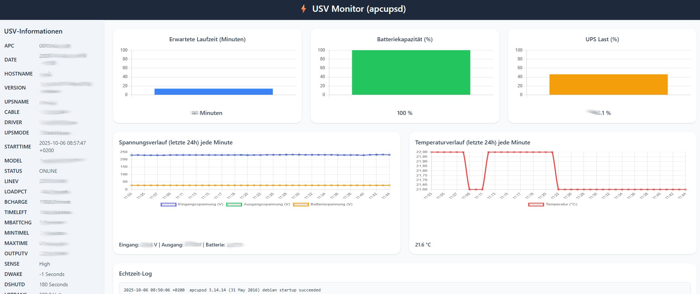

# APC UPS Monitor – Webinterface für apcupsd

[🇬🇧 English](README.md)

Eine moderne Weboberfläche zur Überwachung deiner APC-USV mit apcupsd. Sie zeigt den aktuellen Status sowie Diagramme für Batterie, Last und Spannung in Echtzeit an und sendet alle Werte der USV über MQTT, Netzausfälle sofort.



## Funktionen

* Echtzeit-USV-Status und Eventlog
* Balkendiagramme für:

  * Erwartete Laufzeit (Minuten)
  * Batteriekapazität (%))
  * UPS-Last (%)
* Liniendiagramme (letzte 24h) für:

  * Batteriespannung, Ausgangsspannung, Eingangsspannung
  * Temperatur
* Responsive Design für Desktop und Mobile
* CSV-basierte Historie für Langzeitdiagramme (24h)
* Systemd-Service für automatischen Start unter Debian
* MQTT

## Systemvoraussetzungen

* Debian / Ubuntu
* Node.js (aktuelle LTS-Version empfohlen)
* npm
* `apcupsd` installiert und konfiguriert

## Installation Docker-Compose

### Requirements for Docker-Version
- docker mit compose plugin installieren
- "NETSERVER on" und "NISIP 0.0.0.0" in der /etc/apcupsd/apcupsd.conf setzen
- Die "APC_HOST" Variable in der docker-compose.yml setzen
  
```bash
mkdir /opt/apcupsdif
cd /opt/apcupsdif
wget https://github.com/bmetallica/apcupsd_monitor/blob/main/docker-compose.yml

docker compose up -d

```

## Installation manual

1. Repository klonen:

```bash
git clone https://github.com/bmetallica/apcupsd_monitor.git
cd apcupsd_monitor
```

2. Abhängigkeiten installieren:

```bash
npm install
```

3. Systemd-Service kopieren:

```bash
sudo cp service/apcupsd-web.service /etc/systemd/system/
```

> ⚠️ Passe den Pfad zur Anwendung und ggf. den Node.js-Pfad in `/etc/systemd/system/apcupsd-web.service` an (Standard: `/usr/bin/env node`).

4. Systemd neu laden und Service aktivieren:

```bash
sudo systemctl daemon-reload
sudo systemctl enable apcupsd-web.service
sudo systemctl start apcupsd-web.service
```

5. Browser öffnen und aufrufen:

```
http://<server-ip>:3000
```

## MQTT

Aktivierung und Einstellungen erfolgen über das Zahnrad in der Weboberfläche. Das **Sendeintervall** ist dort in Sekunden einstellbar (Standard 60, Minimum 5). Die USV wird unabhängig davon alle 5 Sekunden abgefragt: Statusänderungen werden sofort gesendet.

Mit dem Standard-Topic `usv/status`:

| Topic | Inhalt | Retained |
| --- | --- | --- |
| `usv/status/on_battery` | `true` = USV läuft auf Batterie, `false` = Netzstrom vorhanden | ja |
| `usv/status/power_state` | `mains`, `battery` oder `unknown` (z.B. Verbindung zur USV verloren) | ja |
| `usv/status/event` | Einmalig beim Wechsel: JSON mit `event` = `power_lost` oder `power_restored` | nein |
| `usv/status/available` | `online` oder `offline` (Monitor oder apcupsd nicht erreichbar) | ja |
| `usv/status/<WERT>` | Jeder Wert von `apcaccess`, z.B. `STATUS`, `BCHARGE`, `TIMELEFT`, `LINEV`, `LOADPCT` | ja |
| `usv/status` | Alle Werte zusammen als JSON | ja |

Werte mit Einheit werden als reine Zahl gesendet (`230.0 Volts` wird zu `230`).

## Nutzung

* Die Hauptseite zeigt links USV-Informationen, rechts Charts und Logs.
* Die Diagramme werden alle 5 Sekunden automatisch aktualisiert.
* Historische Werte werden in `history.csv` im Projektordner gespeichert.

## Lizenz

MIT License

